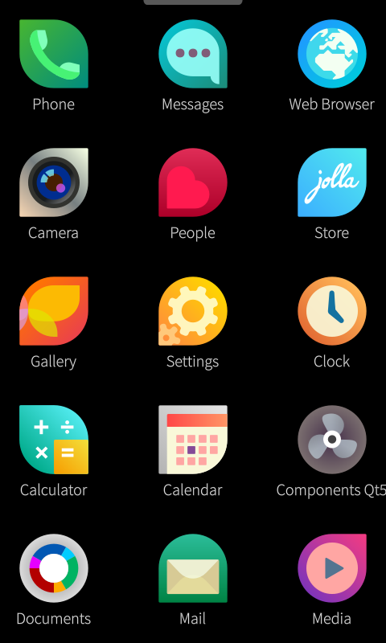
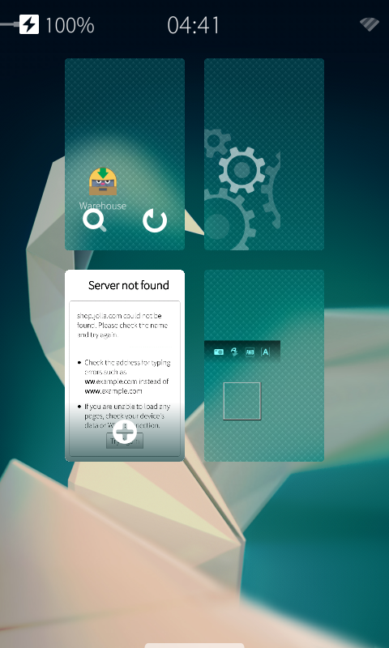

# Sailfish OS 2.0.1.11 on HTC HD2

[English](README.md) | **简体中文**

HTC HD2 / Leo（576 MB RAM、1024 MB ROM）的非官方 Sailfish SD 移植，采用 Android 4.4.1 / NexusHD2 CM11 HAL、tytung 2.6.32 内核和 Xperia anzu 的 Sailfish 2.0.1.11 用户空间。

**[下载本阶段最终实验版 alpha3](https://github.com/DCMMC/hd2-sailfish-os/releases/tag/v2.0.1.11-hd2-alpha3)** · [修复过程与调试证据](docs/ENGINEERING.md) · [构建说明](docs/BUILD.md) · [XDA 英文发帖草稿](docs/XDA-POST.en.md) · [Smartisan 姊妹项目](https://github.com/DCMMC/hd2-smartisan-os)

**用户已确认显示、点击、滑动解锁、声音和振动正常；Wi-Fi 和相机仍不可用。** 按用户要求停止继续修复，发布当前成果。alpha3 是本阶段的最终快照，仍是硬件功能不完整的实验版。

## 实机截图

 

两张截图均在发布前从当前手机真实 framebuffer 采集。黑色的相机预览和浏览器连接失败是已知问题，未用效果图替代。[截图来源与采集方法](screenshots/README.md)。

## 功能状态

| 功能 | 最终状态 |
| --- | --- |
| MAGLDR SD 启动、systemd、Android HAL | 实机启动和重启验证 |
| 480×800 显示、点击、滑动解锁 | 用户确认正常 |
| 声音、振动 | 用户确认正常；未覆盖所有音频路由/通知场景 |
| USB ADB 与 root 救援终端 | 默认开启，实机已连接 |
| Wi-Fi | 驱动扫描部分恢复，曾枚举网络；用户报告仍不能使用 |
| 相机 | 传感器可启动，预览缓冲分配失败，仍黑屏 |
| 通话、数据、GPS、蓝牙、传感器、休眠 | 未完成验证 |

## 安装

1. 下载 `hd2-sailfish-2.0.1.11-alpha3-SD.zip`，核对同名 `.sha256`。
2. 解压，把完整 `HD2-SF` 目录放到 SD 第一分区 FAT32 根目录。至少需要 2.1 GiB；其中 `rootfs.ext4` 为 2 GiB 文件。
3. MAGLDR → `Services` → `BootSettings` → `AD SD Dir` → `HD2-SF`，然后 `Boot AD SD`。
4. 默认启动：`Boot source` 选 `Android from SD`，`AlwaysMenu` 设为 `NO`。

这是 SD 镜像包，不是 Recovery 卡刷包；不刷 NAND，不要求改动 ext4 或 WP7 分区。已有安装的 `rootfs.ext4` 包含用户设置，直接覆盖会丢失这些设置，请先保存旧镜像。

## 默认调试入口

```sh
adb devices
adb shell
adb pull /run/hd2-logs
```

ADB 早期可能以 uid 2000 运行。USB RNDIS 接口配置电脑地址 `192.168.2.14/24` 后，可用默认 root 救援入口：

```sh
telnet -b 192.168.2.14 192.168.2.15 2323
```

这些调试入口自动开启，不依赖界面授权。运行日志在内存 `/run/hd2-logs`，重启清空；早期日志在 FAT32 的 `HD2-SF/early-boot.log`。空文件 `SYSTEMD_DEBUG` 可开启详细启动日志；`DIAGNOSTIC_ONLY` 可停在 initramfs 诊断环境。

## 已包含的补丁

启动/ADB、cgroup/SECUREBITS/accept4、旧 systemd 服务兼容、正确 bionic 库路径、活跃用户会话、RGBX8888、gralloc 回调与双缓冲、主题比例、阻止可靠解锁的 Wayland 服务端内存分配崩溃修复、44100 Hz 音频和 Android 振动后端。另保留了未完全解决功能的 WEXT 扫描补丁和相机快门声等待修复。

代码、探针、调试记录、反汇编及解决方案均在 `tools/`、`configs/`、`logs/` 和 `docs/`；输入来源与提交见 `sources.lock.json`。Release 同时提供本次修改后的内核源码归档。精确补丁/哈希见 [PATCH-MANIFEST.json](release/PATCH-MANIFEST.json)。

alpha3 在电脑上的干净镜像中合入了已在手机增量测试的补丁；重新打包后的整个干净镜像未再次冷启动。保留 donor 的 RPM 记录，不支持官方 OTA 升级。第三方组件及版权说明见 [NOTICES.md](NOTICES.md)。
