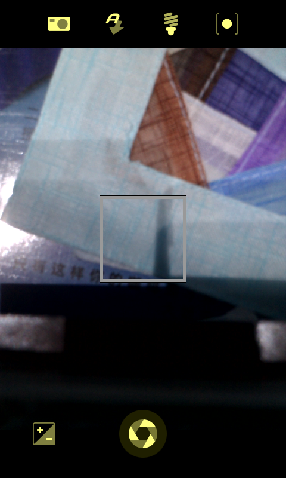

# Sailfish OS 2.0.1.11 on HTC HD2

[English](README.md) | **简体中文**

HTC HD2 / Leo（576 MB RAM、1024 MB ROM）的非官方 Sailfish SD 移植，采用 Android 4.4.1 / NexusHD2 CM11 HAL、tytung 2.6.32 内核和 Xperia anzu 的 Sailfish 2.0.1.11 用户空间。

**[下载 alpha4](https://github.com/DCMMC/hd2-sailfish-os/releases/tag/v2.0.1.11-hd2-alpha4)** · [修复过程与调试证据](docs/ENGINEERING.md) · [构建说明](docs/BUILD.md) · [XDA 英文发帖草稿](docs/XDA-POST.en.md) · [Smartisan 姊妹项目](https://github.com/DCMMC/hd2-smartisan-os)

**当前实机上的显示、点击、滑动解锁、内置扬声器、振动、Wi-Fi 连接、相机预览/拍照和相册双指缩放均已工作。** alpha4 已把这些 alpha3 之后的修复装入重新生成的干净 SD 镜像。

## 实机截图

   

四张图均直接采集自手机 framebuffer；后两张展示 alpha4 包含的相机和相册补丁，没有使用效果图。[截图来源与采集方法](screenshots/README.md)。

## 功能状态

| 功能 | 最终状态 |
| --- | --- |
| MAGLDR SD 启动、systemd、Android HAL | 实机启动和重启验证 |
| 480×800 显示、点击、滑动解锁 | 用户确认正常 |
| 声音、振动 | 用户确认扬声器和振动正常；扬声器启动另有声学回录验证。听筒、有线耳机和蓝牙音频尚未测试 |
| USB ADB 与 root 救援终端 | 默认开启，实机已连接 |
| Wi-Fi | WEXT 与运行时修复后可连接，用户已确认 |
| 相机 | 预览和拍照正常；一次冷启动测量中，点击图标后约 6.9 秒打开 HAL 帧设备 |
| 相册 | 可打开图片并连续双指缩放；使用屏幕尺寸纹理以适应 Adreno 200 PMEM 限制 |
| 通话、数据、GPS、蓝牙、传感器、休眠 | 未完成验证 |

当前补丁在正在使用的手机上增量验证。alpha4 干净镜像已完成 66 个关键文件回读、ZIP CRC 和只读文件系统检查，但尚未单独冷启动验证。donor RPM 记录仍保留，不支持官方 OTA。

## 安装

1. 下载 `hd2-sailfish-2.0.1.11-alpha4-SD.zip`，核对同名 `.sha256`。
2. 解压，把完整 `HD2-SF` 目录放到 SD 第一分区 FAT32 根目录。至少需要 2.1 GiB；其中 `rootfs.ext4` 为 2 GiB 文件。
3. MAGLDR → `Services` → `BootSettings` → `AD SD Dir` → `HD2-SF`，然后 `Boot AD SD`。
4. 默认启动：`Boot source` 选 `Android from SD`，`AlwaysMenu` 设为 `NO`。

这是 SD 镜像包，不是 Recovery 卡刷包；不刷 NAND，不要求改动 ext4 或 WP7 分区。已有安装的 `rootfs.ext4` 包含用户设置，直接覆盖会丢失这些设置，请先保存旧镜像。

## 默认调试入口

```sh
adb devices
adb shell
adb pull /run/hd2-logs
```

ADB 早期可能以 uid 2000 运行。USB RNDIS 接口配置电脑地址 `192.168.2.14/24` 后，可用默认 root 救援入口：

```sh
telnet -b 192.168.2.14 192.168.2.15 2323
```

这些调试入口自动开启，不依赖界面授权。运行日志在内存 `/run/hd2-logs`，重启清空；早期日志在 FAT32 的 `HD2-SF/early-boot.log`。空文件 `SYSTEMD_DEBUG` 可开启详细启动日志；`DIAGNOSTIC_ONLY` 可停在 initramfs 诊断环境。

## 已包含的补丁

启动/ADB、cgroup/SECUREBITS/accept4、旧 systemd 服务兼容、正确 bionic 库路径、活跃用户会话、RGBX8888、gralloc 回调与双缓冲、主题比例、Wayland 解锁崩溃、44100 Hz 音频、QDSP 接收设备增益初始化和 Android 振动后端均已包含。后续又完成了 Wi-Fi 连接、相机 allocator/droidmedia/GStreamer 兼容、HAL memlock 回退、异步相机控件、相机专用一次性 QML 预编译，以及相册大图/双指缩放的显存限制修复。相机打开 HAL 的实测时间由约 16.6 秒降到约 6.9 秒，同时不再让其他 Silica 应用重复编译相机。

代码、探针、调试记录、反汇编及解决方案均在 `tools/`、`configs/`、`logs/` 和 `docs/`；输入来源与提交见 `sources.lock.json`。Release 同时提供本次修改后的内核源码归档。精确补丁/哈希见 [PATCH-MANIFEST.json](release/PATCH-MANIFEST.json)。

release 目录中的 alpha4 清单包含当前音频、相机、相册和 Wi-Fi 补丁；实现以 `tools/` 下的脚本和 `logs/` 中的实机记录为准。第三方组件及版权说明见 [NOTICES.md](NOTICES.md)。
